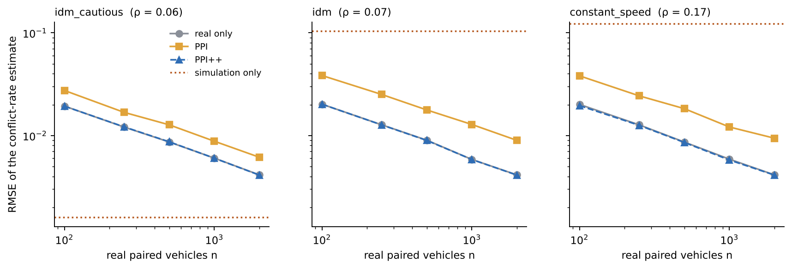
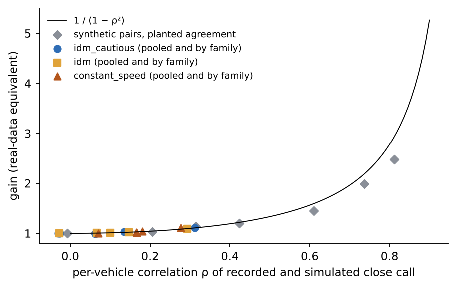
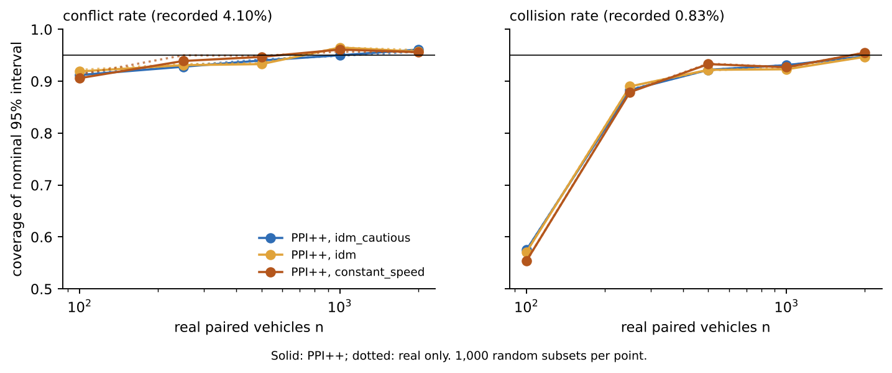
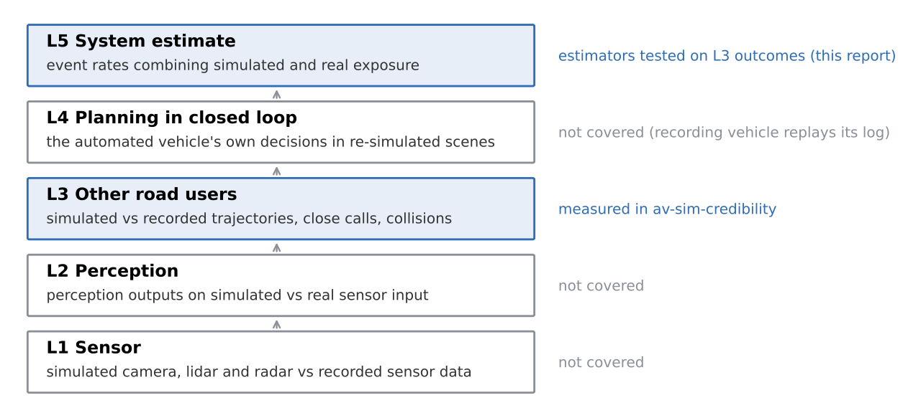

# Summary

A common way to use imperfect simulation without trusting it blindly is to combine it with a smaller set of real results: simulate many scenarios, observe a random subset of the same scenarios in reality, and use the paired subset to correct the simulation's bias. Prediction-powered inference (PPI) and its tuned version PPI++ give unbiased estimates with valid intervals under this design, however biased the simulator is. The open question for a safety engineer is how much real testing such a combination actually saves.

This report answers that question on real driving data. It uses the per-vehicle results of a companion study (av-sim-credibility): 13,195 moving vehicles from 2,000 scenes of the Waymo Open Motion Dataset, each with a recorded outcome and a simulated outcome from closed-loop Waymax simulation with three simple driver models. Because every vehicle has its recorded outcome, the true rate is known, and the estimators can be checked against it over many random subsets.

The main observations are:

- Simulation-only estimates were far off for the default and constant-speed models, and their intervals almost never contained the true rate. Fusion estimators corrected this.
- PPI++ was never meaningfully worse than real data alone, but it also saved little: a few percent of real data at most for the pooled rates, and about 10 to 12% in the best scenario family.
- The reason is low per-vehicle agreement. Correlations between the recorded and simulated close-call indicator were 0.06 to 0.17 pooled and −0.03 to 0.31 by family. The variance reduction follows 1/(1 − ρ²), so halving the real data needs ρ of about 0.7. A planted-agreement experiment at the same sample size reproduced this curve.
- A simulated rate far from the real one limits the achievable correlation. With a 14.4% simulated rate against 4.1% recorded, ρ cannot exceed 0.50 even if every recorded close call were also simulated.
- For the rare collision outcome (0.83% recorded), the normal-approximation intervals of both real-only and fused estimates under-covered badly at small sample sizes (about 55 to 58% at n = 100). Exact or betting-style intervals are needed for rare outcomes.

The practical message is that matching the average rate is not enough for simulation to replace real tests. What makes simulated results valuable in this design is agreement on which individual scenarios are dangerous. The simple rule-based agents used here were not built for that, and these results should not be read as a statement about stronger, learned simulation agents, which this method could evaluate in the same way.

# 1. The question

Real-world testing of automated driving is slow and expensive; simulation is fast and cheap but imperfect. Three ways of using both are common:

1. Use simulation alone and accept its bias.
2. Use real data alone and ignore simulation.
3. Use simulation for volume and a paired real subset to correct it.

The third option is the subject of a growing statistics literature. PPI (Angelopoulos et al., 2023) gives an estimator that stays unbiased when the predictions are biased. PPI++ (Angelopoulos, Duchi and Zrnic, 2023) adds a tuned weight so that the estimate is never worse than the real-only one in large samples. Badithela et al. (2025) applied the same idea to robot policy evaluation with imperfect simulators and reported savings of about 20 to 25% of hardware evaluations in their experiments. The same structure appears in the control-variate methods of Monte Carlo simulation (Lavenberg and Welch, 1981).

For automated driving the relevant questions are practical. How large are the savings with a realistic simulator and realistic outcomes? What property of the simulator controls them? And do the intervals keep their nominal coverage for the rare outcomes that matter for safety?

# 2. Data

The companion study ran each of 2,000 WOMD v1.1 validation scenes twice: as recorded, and with every vehicle other than the recording vehicle controlled by a simulated driver in Waymax. For each of 13,195 moving vehicles it stored two binary outcomes in both versions:

- **Close call (conflict):** minimum time-to-collision below 1.5 s. Recorded rate 4.10%.
- **Collision:** rotated-box overlap with another object. Recorded rate 0.83%. Real crashes are much rarer than this; most recorded overlaps come from tracking and box-size uncertainty. The collision target is therefore a stand-in for a rare outcome rather than a crash rate.

Three simulated-driver settings are used: Waymax's `IDMRoutePolicy` with default parameters (`idm`), the same policy with hand-picked cautious parameters (`idm_cautious`), and a constant-speed model (`constant_speed`). The companion report describes the settings, the measures and the five scenario families (car following, lane change, intersection, pedestrian/cyclist, other).

| Setting | Simulated close-call rate | ρ, close call | Simulated collision rate | ρ, collision |
| --- | --- | --- | --- | --- |
| Recorded | 4.10% |  | 0.83% |  |
| idm_cautious | 4.26% | 0.06 | 6.74% | 0.04 |
| idm | 14.4% | 0.07 | 9.52% | 0.04 |
| constant_speed | 16.3% | 0.17 | 32.4% | 0.02 |

ρ is the per-vehicle correlation of the recorded and simulated binary outcomes over all 13,195 vehicles. The cautious setting matches the pooled close-call rate closely, but its per-vehicle correlation is the lowest of the three.

Per-vehicle values are derived from the Waymo Open Dataset and are not redistributed. The study script reads them from the folder where the companion study wrote them.

# 3. Estimators

Let a large set of N vehicles have only a simulated outcome s, and a random subset of n vehicles have both s and the recorded outcome y. The target is the real rate θ = E[y].

| Estimator | Estimate | Property |
| --- | --- | --- |
| Real only | mean of y over the n paired vehicles | Unbiased; ignores simulation |
| Simulation only | mean of s over all vehicles | Precise but biased by the full gap |
| PPI | mean_N(s) + mean_n(y − s) | Unbiased for any simulator |
| PPI++ | λ·mean_N(s) + mean_n(y − λs), λ tuned | Unbiased; in large samples never worse than real only |

## 3.1 Variance and the tuned weight

For a fixed weight λ,

$$
\hat\theta_\lambda = \lambda\,\bar s_N + \bar y_n - \lambda\,\bar s_n, \qquad \mathrm{Var}(\hat\theta_\lambda) = \frac{\lambda^2 V_s}{N} + \frac{V_y - 2\lambda C + \lambda^2 V_s}{n}
$$

with V_y and V_s the variances of y and s and C their covariance. Setting the derivative in λ to zero gives

$$
\lambda^* = \frac{C}{(1 + n/N)\,V_s}
$$

which the code clips to [0, 1], so the estimate always lies between real only (λ = 0) and plain PPI (λ = 1). The estimate is unbiased for any fixed λ; estimating λ from the same data introduces a bias that vanishes with n.

## 3.2 What simulation is worth

Substituting λ* into the variance and writing ρ = C/√(V_y V_s),

$$
\mathrm{Var}_{\min} = \frac{V_y}{n}\Big[1 - \frac{\rho^2}{1 + n/N}\Big], \qquad \text{gain} = \frac{V_y / n}{\mathrm{Var}_{\min}} \approx \frac{1}{1 - \rho^2} \quad (N \gg n)
$$

The gain is the factor by which the paired real sample would have to grow to match the fused estimate without simulation. It depends on the correlation alone, not on how close the simulated rate is to the real one.

| ρ | 0.3 | 0.5 | 0.7 | 0.8 | 0.9 |
| --- | --- | --- | --- | --- | --- |
| Gain | 1.10 | 1.33 | 1.96 | 2.78 | 5.26 |

A gain of 2 needs ρ ≈ 0.71; a gain of 10 needs ρ ≈ 0.95.

## 3.3 A ceiling set by the rates

For binary outcomes with rates p_r < p_s, the largest possible correlation is reached when every real event is also a simulated event:

$$
\rho_{\max} = \sqrt{\frac{p_r\,(1 - p_s)}{p_s\,(1 - p_r)}}
$$

With p_r = 0.041 and the default-IDM rate p_s = 0.144, ρ_max = 0.50 and the gain cannot exceed 1.33 whatever the simulator does vehicle by vehicle. With the cautious rate of 0.043, ρ_max = 0.98. Calibrating the rate does not create agreement, but it removes this ceiling.

## 3.4 Worked example

Default IDM, pooled close calls, n = 500 paired vehicles and N = 12,695 simulated-only. The recorded rate is 0.041 and the simulated rate 0.144, with ρ = 0.066. Then V_y = 0.0393, V_s = 0.1234 and C = 0.0046, so Var(y − s) = 0.153.

- Real only: standard error √(0.0393/500) = 0.0089.
- Plain PPI: standard error √(0.153/500 + 0.1234/12,695) = 0.0178, twice as large, because subtracting a weakly related simulated value adds noise.
- PPI++: λ* = 0.0046/(1.039 × 0.1234) = 0.036, which almost switches simulation off and returns the real-only precision.

These figures match the root-mean-square errors observed in the study (0.0090 for real only, 0.0178 for PPI).

## 3.5 Assumptions

The paired vehicles are a random sample of the full set, the recorded and simulated outcomes refer to the same vehicle in the same scene, and the simulated-only vehicles come from the same distribution as the target. Intervals use the normal approximation (z = 1.96). Section 5.4 shows where that approximation fails.

# 4. Study design

Because every vehicle has its recorded outcome, the full-data recorded rate is treated as the truth. For each setting, target and group (pooled, or one scenario family), the study repeats 1,000 times:

1. draw n vehicles at random as the "paired" set and treat the rest as simulation-only;
2. compute each estimator and its 95% interval;
3. record the error and whether the interval contains the truth.

It reports root-mean-square error (RMSE), interval coverage and the gain (RMSE of real only divided by RMSE of PPI++, squared). Pooled runs use n = 100, 250, 500, 1,000 and 2,000; family runs use n = 250 and 500.

A synthetic experiment checks the theory. Pairs of binary outcomes with a 4% rate are generated from a bivariate normal with a planted latent correlation, at the real sample sizes (N = 13,195, n = 500), and analysed in exactly the same way.

# 5. Results

## 5.1 Pooled estimates

n = 500 paired vehicles, 1,000 random subsets.

| Setting | Target | Simulated rate | ρ | RMSE real only | RMSE simulation only | RMSE PPI | RMSE PPI++ | PPI++ coverage | Gain |
| --- | --- | --- | --- | --- | --- | --- | --- | --- | --- |
| idm_cautious | close call | 4.26% | 0.06 | 0.0087 | 0.0016 | 0.0127 | 0.0087 | 94% | 0.99 |
| idm | close call | 14.4% | 0.07 | 0.0090 | 0.1032 | 0.0178 | 0.0090 | 93% | 1.01 |
| constant_speed | close call | 16.3% | 0.17 | 0.0086 | 0.1219 | 0.0183 | 0.0086 | 95% | 1.02 |
| idm_cautious | collision | 6.74% | 0.04 | 0.0039 | 0.0591 | 0.0120 | 0.0039 | 92% | 1.00 |
| idm | collision | 9.52% | 0.04 | 0.0038 | 0.0869 | 0.0137 | 0.0038 | 92% | 1.00 |
| constant_speed | collision | 32.4% | 0.02 | 0.0039 | 0.3156 | 0.0214 | 0.0039 | 93% | 1.00 |

{width=100%}

Simulation-only estimates were far from the truth for every setting except one, and their intervals contained it in none of those cases. The exception is the cautious setting's pooled close-call rate, which happens to match (4.26% against 4.10%); per family, its lane-change rate is half the recorded one.

Plain PPI was valid but noisier than real data alone, as the worked example predicts. PPI++ set its weight close to zero and returned essentially the real-only precision. Gains between 0.99 and 1.02 at n = 500 mean that, pooled, simulation saved at most about 2% of real data (up to about 5% at other sample sizes).

## 5.2 By scenario family

Close-call target, n = 500.

| Setting | Family | ρ | Gain |
| --- | --- | --- | --- |
| idm_cautious | Car following | −0.03 | 1.00 |
| idm_cautious | Lane change | −0.03 | 1.00 |
| idm_cautious | Intersection | 0.31 | 1.11 |
| idm_cautious | Pedestrian / cyclist | 0.14 | 1.03 |
| idm | Car following | −0.03 | 1.00 |
| idm | Lane change | 0.10 | 1.01 |
| idm | Intersection | 0.29 | 1.09 |
| idm | Pedestrian / cyclist | 0.15 | 1.02 |
| constant_speed | Car following | 0.18 | 1.04 |
| constant_speed | Lane change | 0.28 | 1.11 |
| constant_speed | Intersection | 0.17 | 1.01 |
| constant_speed | Pedestrian / cyclist | 0.07 | 1.00 |

The largest close-call gain was 1.11 (intersection under the cautious setting, and lane change under constant speed), about 10% fewer paired real vehicles for the same precision. The largest gain anywhere in the study was 1.13 (about 11% fewer), for the collision target in lane changes under the cautious setting (ρ = 0.32). PPI++ coverage for the family runs was 95 to 98% for close calls and 88 to 97% for collisions at n = 500.

Constant speed, the least realistic setting by every validation measure in the companion study, has some of the highest correlations. Correlation and calibration are different properties: the fusion estimators reward the first and correct the second.

## 5.3 How much agreement is needed

| Observed ρ (synthetic) | −0.01 | 0.06 | 0.21 | 0.31 | 0.42 | 0.61 | 0.74 | 0.81 |
| --- | --- | --- | --- | --- | --- | --- | --- | --- |
| Measured gain | 1.00 | 1.00 | 1.03 | 1.14 | 1.20 | 1.45 | 1.99 | 2.48 |

{width=78%}

The measured gains follow the theoretical curve, slightly below it at high ρ because n/N is not negligible and λ is estimated. The real settings sit in the bottom-left corner. Halving the real data needs ρ of about 0.7.

## 5.4 Interval coverage for rare outcomes

{width=95%}

For close calls (4.10%), PPI++ coverage was between 91% and 98% at every sample size tested. For collisions (0.83%), coverage was about 55 to 58% at n = 100, 88 to 89% at n = 250, 92 to 93% at n = 500 and 1,000, and about 95% at n = 2,000. Real only behaved the same way, so the problem is the normal approximation, not the fusion: at n = 100 the expected number of recorded collisions in the paired set is below one, and a sample with no events gives a zero-width interval. For the rare outcomes that matter most for safety, exact binomial intervals or the betting-based bounds of Waudby-Smith and Ramdas (2024), as used by Badithela et al. (2025), should replace the normal approximation.

## 5.5 Pooling tail ratios across families

The companion study measures a tail ratio R (simulated over recorded close-call frequency) per family. Small families give noisy ratios. A normal-normal model on the log scale with the DerSimonian–Laird estimate of the between-family spread τ (DerSimonian and Laird, 1986) pulls each family toward the overall value in proportion to its noise.

| Family | idm: R raw | idm: R pooled (95% CI) | idm_cautious: R raw | idm_cautious: R pooled (95% CI) |
| --- | --- | --- | --- | --- |
| Car following | 4.40 | 4.37 (3.84 to 4.96) | 1.10 | 1.07 (0.92 to 1.25) |
| Lane change | 4.11 | 3.93 (2.86 to 5.41) | 0.51 | 0.73 (0.52 to 1.04) |
| Intersection | 1.52 | 1.62 (1.21 to 2.16) | 0.81 | 0.86 (0.64 to 1.14) |
| Pedestrian / cyclist | 2.41 | 2.43 (2.01 to 2.93) | 1.08 | 1.04 (0.85 to 1.27) |
| Between-family spread τ (log scale) |  | 0.46 |  | 0.20 |

Families with plenty of data keep almost their own value; the smallest family moves most (lane change under the cautious setting, from 0.51 to 0.73). The spread τ is itself informative: a simulator with a large τ cannot be corrected with one global factor. With only four families τ is uncertain, and a fully Bayesian fit with a prior on τ would be the natural refinement.

# 6. Where this sits in a simulation validation plan

A simulator used for safety evidence is a chain of models, and evidence about one link does not transfer automatically to the others. A common way to organise validation is by integration level, with paired comparisons at interfaces that both the simulation and the real system produce.

{width=88%}

| Level | Simulated output | Real reference | Example metrics | Claim it supports |
| --- | --- | --- | --- | --- |
| L1 Sensor | Camera, lidar, radar returns | Recorded sensor data of the same scene | Per-point and per-pixel residuals by condition | Sensor-model error does not change perception beyond tolerance |
| L2 Perception | Detections and tracks on simulated input | Perception on recorded input, labels | Recall and precision by range and class | Planning tests do not hinge on simulation artefacts |
| L3 Other road users | Simulated trajectories | Logged trajectories | δ, ω, R, attributed collisions per family | Simulated traffic creates close calls at the real rate |
| L4 Planning in closed loop | The automated vehicle's decisions and outcomes | Re-simulation and on-road outcomes | Collisions, near misses, rule violations | Simulated outcomes predict on-road outcomes within stated uncertainty |
| L5 System estimate | Event rates over the scenario mix | Fleet exposure and events | Rates with bounds; fusion gain and coverage | Simulated exposure counts with a stated weight |

The companion study measured L3; this report tested L5 estimators on L3 outcomes. L1, L2 and L4 were not covered, and in particular the recording vehicle replays its log throughout, so nothing here concerns an automated driving system's own behaviour. The same scenario families can be used at every level so that a weakness found low in the chain can be traced to the claims it limits. The `levels.py` module records this table in code.

# 7. Implications

The results suggest a few practical points for anyone combining simulated and real results in a safety estimate:

- **Track per-scenario agreement, not only rates.** The paired correlation ρ (or the scatter ω of the companion study) sets how much real testing simulation can replace. A simulator can match the pooled rate and still contribute almost nothing.
- **Calibrate rates first.** A large rate mismatch caps ρ and therefore the gain, whatever the per-scenario behaviour.
- **Keep a refreshed, randomly sampled paired set.** The correction term needs real outcomes for scenarios that were also simulated with the current simulator and software. Without randomness the correction is not unbiased.
- **Use estimators that tolerate bias, and check coverage.** PPI++ never did meaningfully worse than real data alone here, while simulation-only intervals usually missed the truth. Coverage can be checked by re-sampling the paired set before a number is used.
- **Use exact or betting-style intervals for rare outcomes.** Normal intervals under-covered badly for a 0.8% rate at small n, for real-only and fused estimates alike.
- **Report by scenario family.** Agreement varied from none (car following) to modest (intersections), so any weight on simulation should be set per family.

# 8. Limitations

| Limitation | Effect |
| --- | --- |
| Simple rule-based driver models | Low ρ is expected for such models; learned simulation agents may agree much more and should be tested with the same design |
| Recording vehicle replays its log | Results concern other road users (L3), not an automated driving system |
| Close call defined by one-dimensional TTC | Crossing conflicts are under-counted |
| Collision target includes tracking noise | It is a stand-in for a rare outcome, not a crash rate |
| Random paired subsets drawn from the same 2,000 scenes | Real deployments need a sampling frame that matches the exposure of interest, or importance weights |
| Normal-approximation intervals | Under-cover for rare outcomes at small n (Section 5.4) |
| Four families for the hierarchical model | The between-family spread is itself uncertain |

# 9. Reproducing the results

| Path | Content |
| --- | --- |
| `src/simfusion/fusion.py` | Real-only, simulation-only, PPI and PPI++ estimators; gain; correlation ceiling; hierarchical pooling |
| `src/simfusion/levels.py` | The integration-level table of Section 6 |
| `scripts/fusion_study.py` | The study of Sections 4 and 5, including the synthetic experiment and the hierarchical model |
| `scripts/make_figures.py` | Figures of this report, from the result files |
| `scripts/build_report.py` | Word and PDF versions of this report |
| `tests/test_core.py` | Four tests: bias correction and coverage on a synthetic simulator, shrinkage, the levels table, the gain formula |

```bash
pip install -r requirements.txt
python tests/test_core.py
python scripts/fusion_study.py --agents-dir ../av-sim-credibility/results   # needs the per-vehicle files
python scripts/make_figures.py
```

`fusion_study.py` reads `womd_agents_<setting>.csv` written by `av-sim-credibility/scripts/womd_pilot.py`. Those files are derived from the Waymo Open Dataset and are not part of either repository. The aggregate outputs in `results/` (`fusion_study.csv`, `fusion_hierarchical.csv`, `fusion_synthetic_sweep.csv`, `fusion_study.json`) are enough to rebuild every table and figure. The random seed is fixed (2026), and a rerun reproduces the result files exactly.

# Notes

**Data.** Results are derived from the Waymo Open Dataset (waymo.com/open), used under its licence for non-commercial research. No scene data or per-vehicle values are redistributed.

**Tools.** Parts of the code and text were drafted with an AI assistant. The study design, the runs on the dataset, the checks of every reported number and the conclusions are the author's.

# References

- Angelopoulos, A. N., Bates, S., Fannjiang, C., Jordan, M. I., Zrnic, T. (2023). Prediction-powered inference. Science 382, 669–674.
- Angelopoulos, A. N., Duchi, J. C., Zrnic, T. (2023). PPI++: efficient prediction-powered inference. arXiv:2311.01453.
- Badithela, A., Snyder, D., Zha, L., Mikhail, J., O'Kelly, M., Dixit, A., Majumdar, A. (2025). Reliable and scalable robot policy evaluation with imperfect simulators. arXiv:2510.04354.
- DerSimonian, R., Laird, N. (1986). Meta-analysis in clinical trials. Controlled Clinical Trials 7, 177–188.
- Ettinger, S. et al. (2021). Large scale interactive motion forecasting for autonomous driving: the Waymo Open Motion Dataset. ICCV.
- Gulino, C. et al. (2023). Waymax: an accelerated, data-driven simulator for large-scale autonomous driving research. NeurIPS Datasets and Benchmarks.
- Lavenberg, S. S., Welch, P. D. (1981). A perspective on the use of control variables to increase the efficiency of Monte Carlo simulations. Management Science 27, 322–335.
- Treiber, M., Hennecke, A., Helbing, D. (2000). Congested traffic states in empirical observations and microscopic simulations. Physical Review E 62, 1805–1824.
- Waudby-Smith, I., Ramdas, A. (2024). Estimating means of bounded random variables by betting. Journal of the Royal Statistical Society Series B 86, 1–27.
